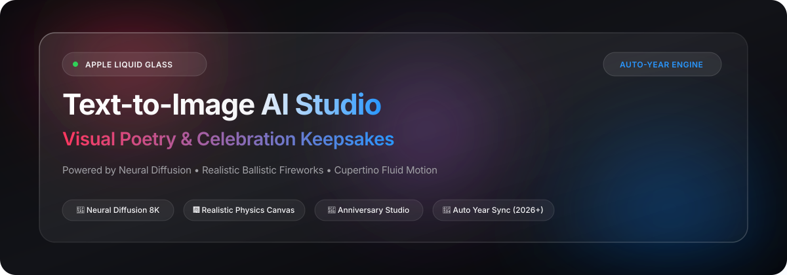
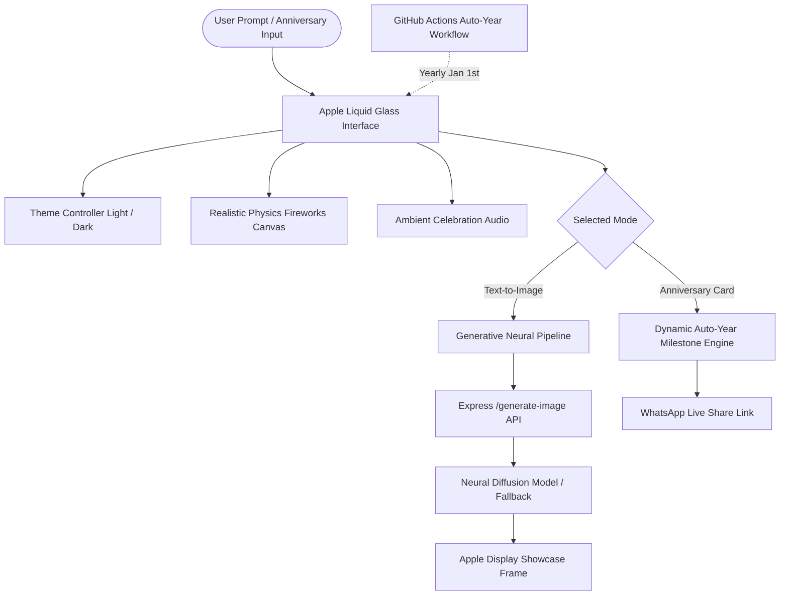

<div align="center">



<br/><br/>

[](https://github.com/Rahul08319/Text-to-Image)
[](https://developer.apple.com/design/)
[](https://github.com/Rahul08319/Text-to-Image)
[](LICENSE)

<p align="center">
  <b>A breathtaking web studio combining ultra-realistic neural image synthesis with personalized milestone celebration cards — crafted with Apple Human Interface Guidelines, Liquid Glass aesthetics, and physics-driven particle animations.</b>
</p>

---

</div>

## 🌟 Visual Showcase & Experience

```
┌────────────────────────────────────────────────────────────────────────┐
│   Text-to-Image Studio                 [Live 2026] [🎵] [🌙] [GitHub] │
├────────────────────────────────────────────────────────────────────────┤
│                                                                        │
│            Transform Words into Visual Poetry.                         │
│                                                                        │
│    [ 🎨 AI Image Studio ]        [ 💖 Celebration & Milestones ]       │
│  ┌──────────────────────────────────────────────────────────────────┐  │
│  │ 🪄 Describe your scene: "Sunset over Amalfi Coast, cinematic..." │  │
│  │ Presets: [📷 Photorealistic] [🍏 Cupertino] [🎬 Cinema] [🌸 Anime]│  │
│  │ Aspect:  [1:1 Square] [16:9 Landscape] [9:16 Story] [4:3 Classic]│  │
│  │                                                                  │  │
│  │   [ ✨ Generate Masterpiece ]      [ 🧹 Clear Prompt ]           │  │
│  └──────────────────────────────────────────────────────────────────┘  │
│                                                                        │
│  ┌──────────────────────── Display Frame ───────────────────────────┐  │
│  │                                                                  │  │
│  │                [ Real High-Resolution AI Artwork ]               │  │
│  │                                                                  │  │
│  │             [ 📥 Download ]  [ 🔗 Copy ]  [ ⛶ Fullscreen ]       │  │
│  └──────────────────────────────────────────────────────────────────┘  │
│                                                                        │
│     * Ambient Fireworks Particles * Floating Hearts * Romantic Music   │
│     © 2026 Rahul08319 • Automatically Synced for Future Years (2026+)  │
└────────────────────────────────────────────────────────────────────────┘
```

---

## ✨ Bento Feature Highlights

| 🎨 Neural Diffusion Studio | 🍏 Apple Liquid Glass UI |
| :--- | :--- |
| **Instant High-Res Generation**<br>Generates hyper-detailed 8K artwork from natural language prompts using state-of-the-art diffusion models.<br>• Multiple aspect ratios (`1:1`, `16:9`, `9:16`, `4:3`)<br>• One-click curated artistic styles & inspiration pills | **Cupertino Design Language**<br>Built following Apple HIG principles (Clarity, Deference, Depth).<br>• Translucent materials with `backdrop-filter: blur(28px)`<br>• Dynamic Light & Dark Mode toggle with automatic OS detection<br>• San Francisco typography with calibrated tracking |

| 🎆 Physics-Driven Fireworks & Audio | 🔄 Infinite Year Auto-Sync Logic |
| :--- | :--- |
| **Realistic Celebration Physics**<br>Interactive canvas animation engine featuring authentic ballistic trajectory, air drag, gravity acceleration, and glowing spark decay.<br>• Click-anywhere firework launcher<br>• Ambient romantic background audio player | **Zero-Maintenance Longevity**<br>Built-in dynamic time engine that keeps the application perpetually modern without manual edits.<br>• Dynamic milestone calculator (`© Current Year`)<br>• Automated GitHub Actions keep-alive workflow |

---

## 🚀 Quickstart

### 1. Clone the Repository
```bash
git clone https://github.com/Rahul08319/Text-to-Image.git
cd Text-to-Image
```

### 2. Install Dependencies
```bash
npm install
```

### 3. Run Locally
```bash
npm start
```
Open **[http://localhost:3000](http://localhost:3000)** in your browser to experience the studio.

> **Static Preview:** You can also simply open `index.html` directly in any modern browser! The client-side fallback generative engine works out-of-the-box even without a Node server running.

---

## 🛠️ Architecture



---

## 📁 Project Structure

```
Text-to-Image/
├── .github/
│   └── workflows/
│       └── auto-year-sync.yml   # Automated yearly verification & sync
├── css/
│   └── style.css                # Apple Design System (Liquid Glass, SF Stack)
├── js/
│   └── script.js                # Core scripts (Canvas physics, theme, AI engine)
├── index.html                   # Main Apple-grade studio interface
├── script.js                    # Root script mirror
├── server.js                    # Express API server with health & generation
├── package.json                 # Project manifest & dependencies
├── .env.example                 # Environment configuration template
├── .gitignore                   # Clean ignore rules
└── README.md                    # Comprehensive documentation
```

---

## ⚙️ Environment Configuration

Copy `.env.example` to `.env` to customize settings:

```bash
cp .env.example .env
```

```env
PORT=3000
# Optional: Google Gemini API key if using custom Gemini model endpoints
GEMINI_API_KEY=YOUR_API_KEY_HERE
```

---

## 🗓️ Automatic Year Update Logic

This repository features automated year logic so the code and website remain perpetually up-to-date in **2026, 2027, and all coming years**:

1. **Client-Side Real-Time Year Computation:** All copyright, status badges, and anniversary milestones are computed via `new Date().getFullYear()`, automatically adjusting on every device.
2. **Dynamic Anniversary Milestones:** When users input a beginning year (e.g. `2020`), the milestone calculates the exact duration elapsed dynamically (`6th Anniversary in 2026`, `7th in 2027`).
3. **Automated GitHub Actions (`auto-year-sync.yml`):** Runs every year on **January 1st at 00:00 UTC** to verify build integrity and keep the repository active.

---

## 🌐 Deployment Options

### Vercel / Netlify
Deploy in one click by linking your GitHub repository. Since the frontend is self-contained with intelligent fallback generation, it works seamlessly as a zero-config static site or serverless API.

### Docker / VPS
```bash
node server.js
```

---

## 📄 License

Distributed under the **MIT License**. Created with passion and Cupertino design principles by **[Rahul Kumar](https://github.com/Rahul08319)**.
